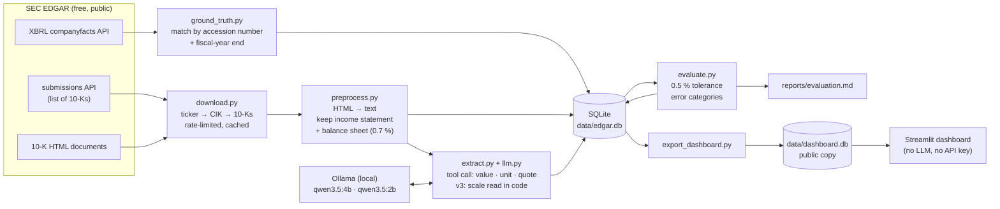

# edgar-extract

> How accurately can a small, free LLM pull five financial metrics out of an SEC 10-K?
> This project measures it against the companies' own XBRL data, explains every error,
> and improves the pipeline measurably — from **75 % to 95 %** for a 2-billion-parameter
> model running on a laptop, at a cost of **$0**.

**Status:** ✅ first complete iteration on a small sample (5 companies × 2 years).


## Problem

A 10-K annual report is hundreds of pages long. This project extracts five numbers
for the fiscal year of the report:

**Revenue · Operating income · Net income · Diluted EPS · Total assets**

"An LLM can extract numbers" is easy to claim. The point here is different:
**measure how accurately it does it, understand why it fails, and improve the system
measurably.** That needs an answer key. Companies also file their statements as XBRL
(machine-readable tags), which the SEC publishes via its `companyfacts` API. Every
extracted value is checked against that ground truth, and every error is sorted into
a category automatically.

Constraint: a budget of zero. So instead of a paid API, the extraction runs on two
free local models via [Ollama](https://ollama.com) — `qwen3.5:4b` and `qwen3.5:2b` —
on an Apple M1 Pro with 16 GB of memory.

## Architecture



Every external call — SEC and LLM — is cached on disk, so re-running the pipeline
never downloads or computes anything twice.

## Results

10 filings × 5 metrics = 50 values per model; 6 have no ground truth (see
[below](#4-guessing-a-metric-the-company-does-not-report)), so **44 values are graded**.
A value is correct if it is within 0.5 % of the XBRL value.

| Version | What changed | qwen3.5:2b | qwen3.5:4b |
|---|---|---|---|
| **v1** | Baseline prompt. The model reports value, unit and a quote per metric. | 75 % (33/44) | 98 % (43/44) |
| **v2** | v1 + a block of *general* rules in the prompt (no company names, no expected numbers). | 77 % (34/44) | 100 % (44/44) |
| **v3** | v2 + the scale (thousands/millions) is read from the table header **in code**; the model's unit is ignored. Same LLM answers as v2, straight from the cache. | **95 % (42/44)** | **100 % (44/44)** |

Errors per category (graded values only):

| Category | 2b v1 | 2b v2 | 2b v3 | 4b v1 | 4b v2 | 4b v3 |
|---|---|---|---|---|---|---|
| Unit error (thousands/millions) | 5 | 8 | **0** | 0 | 0 | 0 |
| Wrong metric (other row) | 5 | 2 | 2 | 0 | 0 | 0 |
| Value missing | 1 | 0 | 0 | 0 | 0 | 0 |
| Other (note reference number) | 0 | 0 | 0 | 1 | **0** | 0 |

Full breakdown per metric, per company and every single error:
[reports/evaluation.md](reports/evaluation.md).

## Most common errors — and what I did about them

### 1. Unit errors: the number was right, the scale was wrong
J&J heads its tables with *"(Dollars and Shares in Millions Except Per Share Amounts)"*.
The 2b model read "Dollars" and reported the unit as plain dollars, so every value came
out a million times too small. In **every** unit error the printed number itself was correct.

- v2 added the rule *"the scale is stated once in the table header"* → unit errors went
  **up** from 5 to 8.
- v3 stopped asking the model for the scale and reads it from the header in code →
  **0 unit errors**, 77 % → 95 %, without a single new LLM call.

**Lesson:** don't try to talk a small model into a task it is bad at. Move that task into
deterministic code and let the model do what it does well (reading a number).

### 2. Wrong row: a component instead of the total
JPMorgan's income statement lists "Noninterest revenue" above "Total net revenue", and
"Net income applicable to common stockholders" below "Net income". ExxonMobil reports net
income both including and excluding noncontrolling interests (XBRL `ProfitLoss` vs
`NetIncomeLoss`). The evaluation detects these by finding the row the model's number came
from, or by matching related XBRL values.

- v2 rules (*"use the line that totals all revenue"*, *"net income attributable to the
  company itself"*) → wrong-metric errors 5 → 2. The two left are both JPMorgan 2024.

### 3. A note number reported as earnings per share
ExxonMobil's statements have a "Note Reference Number" column. The 4b model reported the
note number **12** as diluted EPS instead of **7.84**. Root cause: preprocessing drops
empty table cells, so in rows without a note number the values shift one column to the
left and the columns no longer line up with the header.

- v2 rule *"note reference numbers are not amounts"* → fixed (4b: 98 % → 100 %).
- The root cause in preprocessing is still open (see next steps).

### 4. Guessing a metric the company does not report
J&J, JPMorgan and ExxonMobil report no operating income at all. The right answer is
"not reported"; instead, models filled in *income before taxes*. These cases have no
ground truth, so they are reported separately and not counted in the accuracy.

- v2 rule *"income before income taxes is NOT operating income; otherwise null"* →
  2b: 4 of 6 guessed → **0**. 4b still guesses 2 of 6 (J&J both years).

### 5. Format: numbers as text
The 2b model often filled the numeric field with text such as `"416,161"`. The parser
accepts it (strips commas, reads `(321)` as negative) but records every repair as a
format issue: 43 issues in v1 → 8 in v2 after the rule *"value must be a plain number"*.

### Preprocessing pitfalls found on the way
- A statement title such as "Consolidated Balance Sheets" appears dozens of times in one
  10-K (table of contents, sentences, auditor's report). The real statement is found by
  a title on its own line, typical line items below it, and many numbers right after it.
- Microsoft titles its statements "INCOME STATEMENTS" (no "Consolidated"); ExxonMobil
  writes "Earnings per common share – assuming dilution". Both broke the first heuristics.
- A built-in check confirms that every ground-truth value appears in the shortened text
  (44/44), so a miss is always the model's fault, never the preprocessing's.
- In 2026 ExxonMobil moved its ticker to a new holding company without 10-Ks yet; its
  filings are found under the predecessor's CIK.

## Cost per filing

| Model | Avg input tokens | Avg output tokens | Time per filing* | Cost |
|---|---|---|---|---|
| qwen3.5:2b | 3,045 | 203 | 6.9 s | $0 |
| qwen3.5:4b | 3,045 | 291 | 15.8 s | $0 |

\* Apple M1 Pro, 16 GB, Ollama 0.40, prompt v2/v3.

- **Preprocessing does the heavy lifting:** the full 10-Ks are ~1.3 million tokens
  (estimated), the two statements sent to the model ~9,500 (0.7 %).
- SEC data is free; the whole project cost **$0**.
- For comparison only (not run): at list prices of Oct 2026, `claude-haiku-5-5`
  ($0.10 / $0.50 per million input/output tokens) would cost roughly **$0.0005 per
  filing** for the same prompt. Its tokenizer counts differently, so this is an estimate.

## Limitations

- **Small sample, no held-out set.** 10 filings from 5 companies — and the v2 rules and
  v3 change were developed on the same filings. 100 % / 95 % here is not proof that the
  pipeline generalizes; that needs new companies.
- All five companies report in millions. Detecting thousands/billions is covered by unit
  tests only.
- The quote check is lenient: a quote that is only a row label ("Net earnings") counts as
  found in the source.
- Ground-truth choices matter: ExxonMobil's `Revenues` tag is "Total revenues and other
  income", not "Sales and other operating revenue". `fiscal_year` is the calendar year of
  the fiscal-year end (Microsoft's year ending June 2026 → 2026).

## Next steps

1. Expand to ~20 companies × 5 years as a held-out test set before changing anything else.
2. Keep empty table cells / the note column in preprocessing so columns line up
   (root cause of error 3), and measure it as its own version.
3. Stricter quote check: the quote must contain the reported number.
4. Optionally compare against a hosted model.

## Getting started

Requirements: macOS or Linux, Python 3.11+. Ollama is only needed to re-run the extraction.

### Just look at the dashboard

```bash
git clone https://github.com/<your-username>/edgar-extract.git
cd edgar-extract
python3 -m venv .venv && source .venv/bin/activate
pip install -r dashboard/requirements.txt
streamlit run dashboard/app.py
```

The dashboard reads only `data/dashboard.db`, which is part of the repository.

### Run the full pipeline

```bash
pip install -e ".[dev]"
cp .env.example .env            # set SEC_USER_AGENT="Your Name you@example.com" (required by the SEC)

brew install ollama             # or see https://ollama.com/download
ollama serve                    # keep running in a second terminal
ollama pull qwen3.5:4b
ollama pull qwen3.5:2b

python -m edgar_extract.download           # 10-K documents -> data/cache/
python -m edgar_extract.ground_truth       # XBRL ground truth -> data/edgar.db
python -m edgar_extract.preprocess         # income statement + balance sheet only
python -m edgar_extract.extract --version v3   # also try --version v1 / v2
python -m edgar_extract.evaluate           # -> reports/evaluation.md
python -m edgar_extract.export_dashboard   # -> data/dashboard.db
pytest                                     # 82 tests, no network needed
```

### Deploy the dashboard

On [Streamlit Community Cloud](https://streamlit.io/cloud): *New app* → this repository,
branch `main`, main file `dashboard/app.py`. Dependencies come from
`dashboard/requirements.txt`; no secrets are needed.

## Project structure

```
src/edgar_extract/
  edgar.py, download.py     SEC client: ticker → CIK → 10-K list → document (cached, rate-limited)
  ground_truth.py           XBRL companyfacts → ground truth per filing
  preprocess.py             HTML → text, find income statement + balance sheet
  llm.py, extract.py        Ollama client (cached) and the extraction versions v1–v3
  evaluate.py               grading, error categories, Markdown report
  export_dashboard.py       public copy of the results for the dashboard
  db.py, config.py          SQLite schema and settings
dashboard/                  Streamlit app (reads data/dashboard.db only)
tests/                      pytest, with small fixtures instead of network calls
reports/evaluation.md       latest evaluation report
data/dashboard.db           public results (data/cache, data/edgar.db stay local)
```

**Tech stack:** Python 3.12 · httpx · BeautifulSoup + lxml · pydantic · SQLite · pandas ·
Ollama · Streamlit + Altair · pytest

## License

[MIT](LICENSE)
