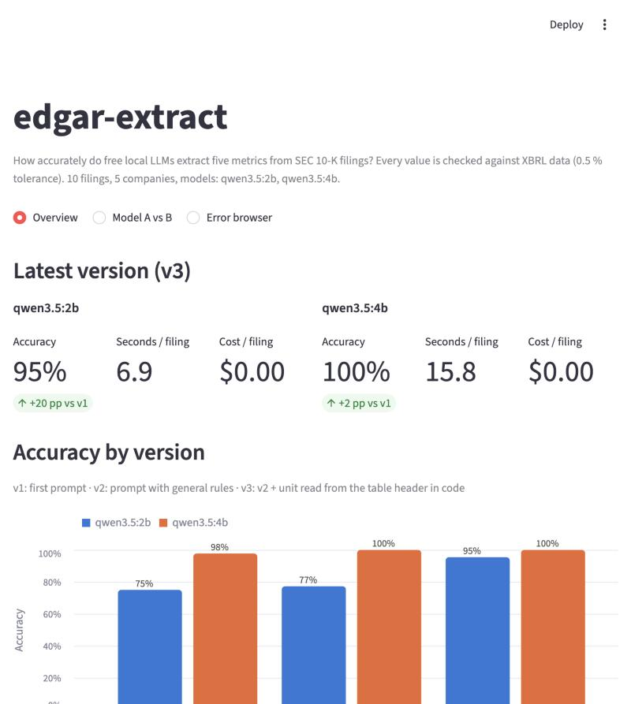
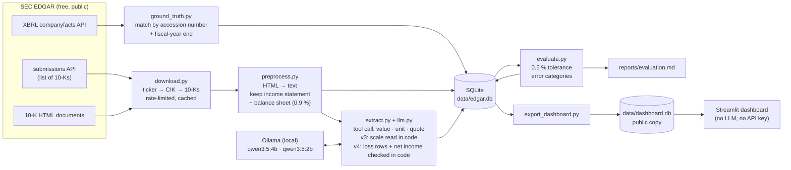

# edgar-extract

> How accurately can a small, free LLM pull five financial metrics out of an SEC 10-K?
> This project measures it against the companies' own XBRL data, explains every error,
> and improves the pipeline measurably — from **75 % to 100 %** on the development set for a
> 2-billion-parameter model running on a laptop, at a cost of **$0**. On **15 companies added
> only after the latest version was written**, the 2b model scores **95 %** (v3: 88 %) and the
> 4b model **97 %** (v3: 95 %).

**Status:** ✅ development set (5 companies × 2 years) + two held-out test sets
(20 + 15 companies × 5 years, 175 filings) · pipeline v4.



## Problem

A 10-K annual report is hundreds of pages long. This project extracts five numbers
for the fiscal year of the report:

**Revenue · Operating income · Net income · Diluted EPS · Total assets**

"An LLM can extract numbers" is easy to claim. The point here is different:
**measure how accurately it does it, understand why it fails, and improve the system
measurably.** That needs an answer key. Companies also file their statements as XBRL
(machine-readable tags), which the SEC publishes via its `companyfacts` API. Every
extracted value is checked against that ground truth, and every error is sorted into
a category automatically.

Constraint: a budget of zero. So instead of a paid API, the extraction runs on two
free local models via [Ollama](https://ollama.com) — `qwen3.5:4b` and `qwen3.5:2b` —
on an Apple M1 Pro with 16 GB of memory.

## Architecture



Every external call — SEC and LLM — is cached on disk, so re-running the pipeline
never downloads or computes anything twice.

## Results

Three data sets (defined in [`datasets.py`](src/edgar_extract/datasets.py)):

- **Development:** AAPL, MSFT, JNJ, JPM, XOM × latest 2 10-Ks. Every prompt rule and code
  change up to v3 was made while looking at these filings — so their scores are optimistic.
- **Test set 1:** 20 companies added after v3, × latest 5 10-Ks — NVDA, GOOGL, AMZN,
  NFLX, BAC (bank), TRV (insurer), UNH, PFE, WMT and HD (fiscal year ends in January),
  KO, PG, MCD, CAT, BA (losses), CVX, VZ, NEE, V, DIS. Netflix reports in thousands.
  Held out for v3; its errors were then used to design v4, so it is **no longer unseen**.
- **Test set 2:** 15 companies chosen *before* v4 was run on them and never used for
  tuning, × latest 5 10-Ks — INTC, T, CMCSA, UBER, WBD, MRNA, F, DUK (several with losses
  or noncontrolling interests), AIG (insurer), GS (bank), COST (fiscal year ends in
  August/September), ORCL and NKE (May), LLY, LMT. **This is the honest measure for v4.**

A value is correct if it is within 0.5 % of the XBRL value. Metrics a company does not
report (no ground truth) are not graded.

### v4: fixing the two error types found on test set 1

| Model / version | Development (44) | Test set 1 (470) | **Test set 2 (351)** | Test set 2, values printed in the statements (346) |
|---|---|---|---|---|
| qwen3.5:2b / v3 | 95 % | 90 % | 88 % (310) | 89 % (309) |
| qwen3.5:2b / **v4** | **100 %** | **97 %** | **95 % (335)** | **97 % (334)** |
| qwen3.5:4b / v3 | 100 % | 97 % | 95 % (335) | 97 % (334) |
| qwen3.5:4b / **v4** | **100 %** | **97 %** | **97 % (342)** | **99 % (341)** |

v4 = v3 + three changes, each a general rule (no company names, no expected numbers):

1. **Prompt rule for losses:** *"Net loss", "Loss from operations", "Diluted loss per
   share" are the metrics you are looking for — report them as negative numbers; never set a
   value to null just because it is a loss.*
2. **Empty values filled in code:** if the model still leaves operating income, net income or
   diluted EPS empty, code takes the row with the usual label (e.g. "Loss from operations",
   "Net (loss) income", "Diluted loss per share") from the same year column in which the
   model found revenue. A value the model *did* give is never replaced.
3. **Net income checked in code:** if the model's net income is followed by a
   noncontrolling-interests row and a company row, and *group = noncontrolling + company*
   adds up in the same column, the company row is used.

On **test set 2** the 2b model's errors drop from 41 to 16 and the 4b model's from 16 to 9.
Code corrected 28 (2b) and 11 (4b) values there. On test set 1, where the rules were
designed, the 2b model goes from 90 % to 97 % — but that number is optimistic by design.

What v4 did **not** fix, or made worse (test set 2 unless stated):

- **Two noncontrolling rows:** Warner Bros. Discovery splits noncontrolling interests into a
  regular and a "redeemable" row. The check only knows one row, so it does not fire (5 errors
  for 2b, 4 for 4b). Fixing it now would make test set 2 "seen" — it is listed under next steps.
- **More guessing where nothing is reported:** with the new prompt the models fill in
  "income before taxes" as operating income a little more often for companies that report
  no operating income (4b: 9 → 12 of 24 on test set 2; 2b: 5 → 7). The code fallback does
  not do this — the label must say "from operations" or "operating".
- 3 values that v3 had right are wrong in v4 (an EPS left empty or taken from a different
  line) — small changes in the prompt change the model's answers elsewhere, too.
- Remaining real errors on test set 2: net income "applicable to common shareholders"
  (Goldman Sachs, AT&T), EPS from continuing operations or left empty (AIG), one Intel net
  income that still includes noncontrolling interests, and one AT&T filing whose table
  header gives no scale (2 unit errors).
- **Ground-truth artifact:** Duke Energy's XBRL revenue is a note value
  (`RevenueFromContractWithCustomerIncludingAssessedTax`), the statement shows "Total
  operating revenues" — 4 errors per model (the fifth year lands within the 0.5 % tolerance
  by chance), like NextEra on test set 1. The last column leaves out all 5 Duke revenue values.

### Test set 1: did v3 generalize?

v3 pipeline, unchanged; 100 filings × 5 metrics, 30 without ground truth → **470 graded values**.

| Model | Development (44 values) | **Test set 1 (470 values)** | Test set 1, values printed in the statements (460) |
|---|---|---|---|
| qwen3.5:4b | 100 % | **97 % (455/470)** | 99 % (455/460) |
| qwen3.5:2b | 95 % | **90 % (421/470)** | 92 % (421/460) |

Both models lose a few points on unseen companies — as expected, since the development
score was measured on the same filings the rules were written for. The ranking stays the
same and the gap between the models widens (5 → 7 points).

10 of the errors are not the models' fault: the ground-truth value does not appear in the
statements the model reads (the preprocessing coverage check flags exactly these):

- **Disney, operating income (5×):** Disney's income statement has no operating-income
  line; the XBRL value comes from the segment note. Both models correctly returned "not
  reported", which is graded as missing.
- **NextEra, revenue (5×):** the XBRL ground truth is `RevenueFromContractWithCustomer…`
  (a note value, e.g. $23.5 B), while the statement shows "Operating revenues" ($24.8 B).
  Both models report the statement line.

The **real** v3 errors on test set 1 (these became the targets of v4):

| Error | qwen3.5:2b | qwen3.5:4b |
|---|---|---|
| Net income *including* noncontrolling interests (`ProfitLoss`) instead of attributable to the company | 21 | 2 |
| Losses (Boeing): value left empty when the row says "Net loss" / "Loss from operations" | 13 | 1 |
| Other (EPS from continuing operations, net income "applicable to common shareholders", a number from another line, one empty value) | 5 | 2 |
| **Total** | **39** | **5** |

The 2b model's two big error types were seen during development too (ExxonMobil
`ProfitLoss`, JPMorgan "applicable to common") — the v2 rule fixed them there, but it does
**not** generalize: on 20 new companies the small model still picks the wrong net-income
line in 21 cases. The scale-in-code idea (v3) **did** generalize: 0 unit errors on 100 new
filings, including Netflix's thousands. (On test set 2 there are 2 unit errors: one AT&T
filing whose income-statement header states no scale, so the model's unit is used.)

### Development set: how the pipeline was built

10 filings × 5 metrics = 50 values per model; 6 have no ground truth (see
[below](#4-guessing-a-metric-the-company-does-not-report)), so **44 values are graded**.

| Version | What changed | qwen3.5:2b | qwen3.5:4b |
|---|---|---|---|
| **v1** | Baseline prompt. The model reports value, unit and a quote per metric. | 75 % (33/44) | 98 % (43/44) |
| **v2** | v1 + a block of *general* rules in the prompt (no company names, no expected numbers). | 77 % (34/44) | 100 % (44/44) |
| **v3** | v2 + the scale (thousands/millions) is read from the table header **in code**; the model's unit is ignored. Same LLM answers as v2, straight from the cache. | 95 % (42/44) | 100 % (44/44) |
| **v4** | v3 + a prompt rule for loss rows, empty loss rows filled in code, net income checked against noncontrolling interests in code (see above). | **100 % (44/44)** | **100 % (44/44)** |

Errors per category (graded values only):

| Category | 2b v1 | 2b v2 | 2b v3 | 4b v1 | 4b v2 | 4b v3 |
|---|---|---|---|---|---|---|
| Unit error (thousands/millions) | 5 | 8 | **0** | 0 | 0 | 0 |
| Wrong metric (other row) | 5 | 2 | 2 | 0 | 0 | 0 |
| Value missing | 1 | 0 | 0 | 0 | 0 | 0 |
| Other (note reference number) | 0 | 0 | 0 | 1 | **0** | 0 |

Full breakdown per metric, per company and every single error (both data sets):
[reports/evaluation.md](reports/evaluation.md).

## Most common errors — and what I did about them

### 1. Unit errors: the number was right, the scale was wrong
J&J heads its tables with *"(Dollars and Shares in Millions Except Per Share Amounts)"*.
The 2b model read "Dollars" and reported the unit as plain dollars, so every value came
out a million times too small. In **every** unit error the printed number itself was correct.

- v2 added the rule *"the scale is stated once in the table header"* → unit errors went
  **up** from 5 to 8.
- v3 stopped asking the model for the scale and reads it from the header in code →
  **0 unit errors**, 77 % → 95 %, without a single new LLM call.

**Lesson:** don't try to talk a small model into a task it is bad at. Move that task into
deterministic code and let the model do what it does well (reading a number).

### 2. Wrong row: a component instead of the total
JPMorgan's income statement lists "Noninterest revenue" above "Total net revenue", and
"Net income applicable to common stockholders" below "Net income". ExxonMobil reports net
income both including and excluding noncontrolling interests (XBRL `ProfitLoss` vs
`NetIncomeLoss`). The evaluation detects these by finding the row the model's number came
from, or by matching related XBRL values.

- v2 rules (*"use the line that totals all revenue"*, *"net income attributable to the
  company itself"*) → wrong-metric errors 5 → 2. The two left are both JPMorgan 2024.

### 3. A note number reported as earnings per share
ExxonMobil's statements have a "Note Reference Number" column. The 4b model reported the
note number **12** as diluted EPS instead of **7.84**. Root cause: preprocessing drops
empty table cells, so in rows without a note number the values shift one column to the
left and the columns no longer line up with the header.

- v2 rule *"note reference numbers are not amounts"* → fixed (4b: 98 % → 100 %).
- The root cause in preprocessing is still open (see next steps).

### 4. Guessing a metric the company does not report
J&J, JPMorgan and ExxonMobil report no operating income at all. The right answer is
"not reported"; instead, models filled in *income before taxes*. These cases have no
ground truth, so they are reported separately and not counted in the accuracy.

- v2 rule *"income before income taxes is NOT operating income; otherwise null"* →
  2b: 4 of 6 guessed → **0**. 4b still guesses 2 of 6 (J&J both years).

### 5. Format: numbers as text
The 2b model often filled the numeric field with text such as `"416,161"`. The parser
accepts it (strips commas, reads `(321)` as negative) but records every repair as a
format issue: 43 issues in v1 → 8 in v2 after the rule *"value must be a plain number"*.

### 6. Losses and noncontrolling interests (v4)
On test set 1 the 2b model left Boeing's loss years empty ("Net loss", "Loss from
operations") and reported net income *including* noncontrolling interests in 21 filings.
A prompt rule alone fixed only 2 of 4 loss years for Boeing's net income and none of the
operating-income or EPS values. So, as in v3, the task moved into code: fill empty loss rows
from their usual labels, and check net income arithmetically against the noncontrolling
row. Result on the unseen test set 2: 2b 88 % → 95 %, 4b 95 % → 97 %.

**Lesson (again):** a rule in the prompt is a suggestion to a small model; a rule in code is
applied every time — but only where the numbers prove it (group = noncontrolling + company).

### Preprocessing pitfalls found on the way
- A statement title such as "Consolidated Balance Sheets" appears dozens of times in one
  10-K (table of contents, sentences, auditor's report). The real statement is found by
  a title on its own line, typical line items below it, and many numbers right after it.
- Microsoft titles its statements "INCOME STATEMENTS" (no "Consolidated"); ExxonMobil
  writes "Earnings per common share – assuming dilution". Both broke the first heuristics.
- A built-in check confirms that every ground-truth value appears in the shortened text
  (44/44 on development), so a miss is the model's fault, not the preprocessing's.
- **New companies broke the preprocessing, too** (fixed *before* any extraction run on the
  test set, guided only by that coverage check; the 10 development texts stayed byte-identical):
  - Bank of America has summary tables titled "Income statement" and "Average balance
    sheet" in its management discussion, with more numbers than the real statements.
    Fix: prefer titles that say "consolidated".
  - Caterpillar titles its statements "Consolidated Results of Operations for the Years
    Ended December 31" and "Consolidated Financial Position at December 31" and calls net
    income "Profit" — no statement was found at all, so the whole 10-K would have been sent.
  - Pfizer has a restatement table "Consolidated Statements of Income:" in its notes. A
    title ending in a colon is now ignored.
  - The coverage check itself missed losses printed in parentheses and McDonald's amounts
    with one decimal ("25,493.7").
  - Coverage on test set 1: 460/470 values; the 10 misses are the Disney/NextEra
    ground-truth cases above.
- **Test set 2 found two more** (again fixed before any model saw these filings, guided only
  by the coverage check; all 110 earlier texts stayed byte-identical):
  - Moderna labels its net income "Net (loss) income" — the statement finder did not
    recognize it as an income statement in its two loss years.
  - AIG has a quarterly table titled like the income statement, with more numbers. Tables
    with "Three Months Ended" in their header are now skipped.
  - Coverage on test set 2: 346/351; the 5 misses are Duke Energy's revenue (see above).
- In 2026 ExxonMobil moved its ticker to a new holding company without 10-Ks yet; its
  filings are found under the predecessor's CIK.

## Cost per filing

| Model | Avg input tokens | Avg output tokens | Time per filing* | Cost |
|---|---|---|---|---|
| qwen3.5:2b | 3,216 | 210 | 6.6 s | $0 |
| qwen3.5:4b | 3,216 | 309 | 15.4 s | $0 |

\* Apple M1 Pro, 16 GB, Ollama 0.40, v4, all 185 filings. The v4 run took ~48 min (4b) +
~20 min (2b). The code checks of v4 add no measurable time.

- **Preprocessing does the heavy lifting:** the 185 full 10-Ks are ~23.4 million tokens
  (estimated), the two statements sent to the model ~203,000 (0.9 %).
- SEC data is free; the whole project cost **$0**.
- For comparison only (not run): at list prices of Oct 2026, `claude-haiku-5-5`
  ($0.10 / $0.50 per million input/output tokens) would cost roughly **$0.0005 per
  filing** for the same prompt. Its tokenizer counts differently, so this is an estimate.

## Limitations

- **Test set 1 is "used", test set 2 is now the only unseen set.** Fixing the Warner Bros.
  Discovery case (two noncontrolling rows) would use it up, too; the next fix needs a third set.
- Test set 2 was chosen with several loss and noncontrolling-interest companies on purpose,
  to test v4 where it matters. Its scores are therefore not a random sample of all companies.
- The preprocessing fixes above were made after looking at held-out filings (but before any
  model saw them, and without touching prompts). They are general rules, not company names.
- The v4 code checks rely on common row labels and on the model finding revenue; a filing
  whose loss rows use unusual labels is not filled.
- Large US companies only. Netflix confirms the thousands scale; billions is covered by
  unit tests only.
- Ground truth can disagree with the statement (Disney, NextEra above), and some companies
  lack a tag entirely: Caterpillar has no `NetIncomeLoss`, Visa no `EarningsPerShareDiluted`
  (it reports per share class). These values are ungraded or graded against a note value.
- The quote check is lenient: a quote that is only a row label ("Net earnings") counts as
  found in the source.
- Ground-truth choices matter: ExxonMobil's `Revenues` tag is "Total revenues and other
  income", not "Sales and other operating revenue". `fiscal_year` is the calendar year of
  the fiscal-year end (Microsoft's year ending June 2026 → 2026).

## Next steps

1. Net income check for *several* noncontrolling rows (Warner Bros. Discovery) and for
   "applicable to common shareholders" — measured on a **third** set of unseen companies.
2. Stop the guessing of "income before taxes" as operating income that the v4 prompt made
   slightly more frequent.
3. Keep empty table cells / the note column in preprocessing so columns line up
   (root cause of error 3), and measure it as its own version.
4. Stricter quote check: the quote must contain the reported number.
5. Optionally compare against a hosted model.

## Getting started

Requirements: macOS or Linux, Python 3.11+. Ollama is only needed to re-run the extraction.

### Just look at the dashboard

```bash
git clone https://github.com/maurizoffice-lgtm/edgar-extract.git
cd edgar-extract
python3 -m venv .venv && source .venv/bin/activate
pip install -r dashboard/requirements.txt
streamlit run dashboard/app.py
```

The dashboard reads only `data/dashboard.db`, which is part of the repository.

### Run the full pipeline

```bash
pip install -e ".[dev]"
cp .env.example .env            # set SEC_USER_AGENT="Your Name you@example.com" (required by the SEC)

brew install ollama             # or see https://ollama.com/download
ollama serve                    # keep running in a second terminal
ollama pull qwen3.5:4b
ollama pull qwen3.5:2b

python -m edgar_extract.download           # 10-K documents -> data/cache/ (40 companies, see datasets.py)
python -m edgar_extract.ground_truth       # XBRL ground truth -> data/edgar.db
python -m edgar_extract.preprocess         # income statement + balance sheet only
python -m edgar_extract.extract --version v4   # also try --version v1 / v2 / v3
python -m edgar_extract.evaluate           # -> reports/evaluation.md
python -m edgar_extract.export_dashboard   # -> data/dashboard.db
pytest                                     # 109 tests, no network needed
```

### Deploy the dashboard

On [Streamlit Community Cloud](https://streamlit.io/cloud): *New app* → this repository,
branch `main`, main file `dashboard/app.py`. Dependencies come from
`dashboard/requirements.txt`; no secrets are needed.

## Project structure

```
src/edgar_extract/
  edgar.py, download.py     SEC client: ticker → CIK → 10-K list → document (cached, rate-limited)
  datasets.py               development companies and test sets 1 and 2
  ground_truth.py           XBRL companyfacts → ground truth per filing
  preprocess.py             HTML → text, find income statement + balance sheet
  llm.py, extract.py        Ollama client (cached) and the extraction versions v1–v4
  evaluate.py               grading, error categories, Markdown report
  export_dashboard.py       public copy of the results for the dashboard
  db.py, config.py          SQLite schema and settings
dashboard/                  Streamlit app (reads data/dashboard.db only)
tests/                      pytest, with small fixtures instead of network calls
reports/evaluation.md       latest evaluation report
data/dashboard.db           public results (data/cache, data/edgar.db stay local)
```

**Tech stack:** Python 3.12 · httpx · BeautifulSoup + lxml · pydantic · SQLite · pandas ·
Ollama · Streamlit + Altair · pytest

## License

[MIT](LICENSE)
